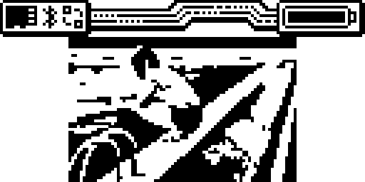
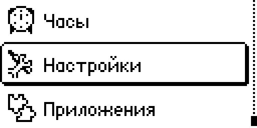
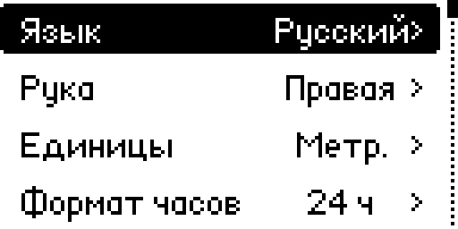
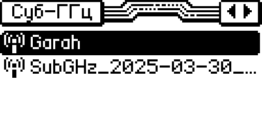
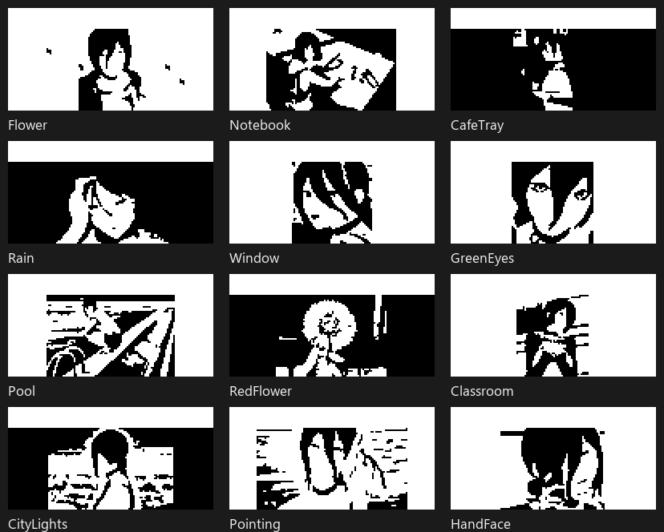

# Reze Unleashed RU/EN

Фанатская прошивка для **Flipper Zero** на базе Unleashed. На рабочем столе — 12 монохромных сцен с Резе из «Человека-бензопилы». В той же сборке доступны русский и английский интерфейс, встроенная справка и перевод части экранов приложений.

[Скачать предварительный релиз](https://github.com/Pystoi1173/Reze-Unleashed-RU-EN/releases/tag/reze-v0.2.0-beta.1) · [Установка](INSTALL_RU.md) · [Руководство](USER_GUIDE_RU.md) · [Что изменилось](RELEASE_NOTES_RU.md) · [Галерея](docs/screenshots/README.md)

## Что изменилось

| Раздел | Изменения |
| --- | --- |
| Рабочий стол | 12 сцен Резе адаптированы для монохромного экрана **128×64**. У всех сцен одинаковые условия доступности и одинаковая вероятность выбора. |
| Русский и English | Язык переключается в **Настройки → Система → Язык**. Строки открытого экрана обновляются сразу. При возврате обновляются меню настроек и главное меню, выбранная позиция сохраняется. |
| Файловый браузер | Переведены заголовки вкладок, в том числе **«Суб-ГГц»**, **«Избр.»** и **«Обзор»**, а также отдельные действия с файлами. Имена файлов сохраняются. |
| Приложения | Переведены отдельные меню, кнопки и сообщения в ИК-порте, NFC, RFID, iButton, Sub-GHz, GPIO, Bad USB, U2F и «Часах». |
| Справка | **Настройки → Справка** / **Settings → User Guide**. Внутри 12 тем по три страницы на каждом языке. |

| Главное меню | Выбор языка | Файловый браузер |
| :---: | :---: | :---: |
|  |  |  |

## Сцены Резе

Каждый кадр подготовлен под разрешение экрана Flipper. Кадрирование и контраст помогают разглядеть лицо, силуэт или ключевую деталь сцены. Когда условия позволяют показать сцены Резе, прошивка выбирает из них случайно. При отсутствии подходящих сцен используется штатный подбор анимаций.

## Установка и проверка

1. Сохраните копию microSD и внутренних настроек Flipper.
2. Скачайте `flipper-z-f7-update-reze-unleashed-ru-en.tgz` из раздела **Assets** и сверьте его с `SHA256SUMS.txt`.
3. В qFlipper откройте **Advanced controls → Install from file** и выберите TGZ. Подробности, совместимость радиостека и вариант установки по USB CLI приведены в [инструкции](INSTALL_RU.md).

Обновление установлено на Flipper Zero по USB CLI. После загрузки подтверждены API `88.28`, BLE Light `1.20.0`, 12 записей сцен на microSD и вкладка **«Суб-ГГц»**. Переключение в обе стороны и сохранение позиции проверены на предшествующей сборке с тем же исправлением меню. Перевод частичный, совместимость сторонних FAP и работа всех аппаратных режимов требуют отдельных проверок. При открытии ИК-порта во время проверки по RPC устройство один раз перезапустилось с сообщением `out of memory`. После перезапуска ИК-порт снова открылся. [Результаты и ограничения](RELEASE_NOTES_RU.md)

## English

**Reze Unleashed RU/EN** is a fan-made Flipper Zero firmware based on Unleashed, featuring 12 monochrome desktop animations of Reze from *Chainsaw Man*. It includes Russian and English UI, a bilingual User Guide, and partial localization of settings and bundled apps. Switch languages in **Settings → System → Language** (Russian: **Настройки → Система → Язык**). Back up your Flipper and microSD before installing the prerelease TGZ from GitHub Releases. The package leaves the installed radio stack in place. [Release](https://github.com/Pystoi1173/Reze-Unleashed-RU-EN/releases/tag/reze-v0.2.0-beta.1) · [Gallery](docs/screenshots/README.md)

## Исходники и авторство

База прошивки — DarkFlippers Unleashed, коммит `53818b18f63e105baaf37ed8eac9a7def58ec8b1`. Для работы с исходниками клонируйте репозиторий с подмодулями (`git clone --recurse-submodules`). [Сборка и устройство локализации](РУССКАЯ_ВЕРСИЯ.md) · [Upstream](https://github.com/DarkFlippers/unleashed-firmware) · [GPL-3.0](LICENSE)

Проект разработан независимо от Flipper Devices, DarkFlippers и правообладателей *Chainsaw Man*. Резе — персонаж манги Тацуки Фудзимото «Человек-бензопила».

## Reze Translate

Отдельный проект для офлайн-перевода английского текста в одиночных играх Windows. В бета-версии доступны OCR, русский перевод поверх игры, профили и файловый режим локализации.

[Репозиторий Reze Translate](https://github.com/Pystoi1173/Reze-Translate) · [Релиз beta2](https://github.com/Pystoi1173/Reze-Translate/releases/tag/v0.1.0-beta2) · [Чат и предложения](https://github.com/Pystoi1173/Reze-Translate/discussions)
