# Reze Unleashed RU/EN на Flipper Zero

Снимки интерфейса получены с подключённого Flipper Zero через USB. Экран 128×64 увеличен в четыре раза без сглаживания. Обзор сцен собран из кадров ресурсов прошивки.

| Рабочий стол | Главное меню |
| :---: | :---: |
| 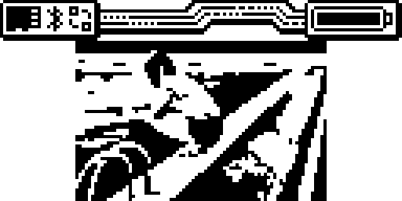 | 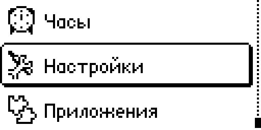 |

| Настройки на русском | Главное меню на английском |
| :---: | :---: |
| 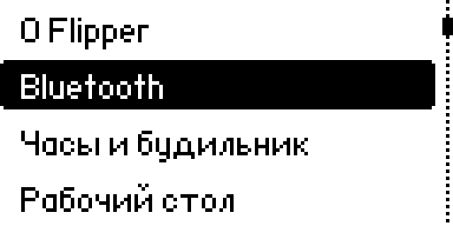 | 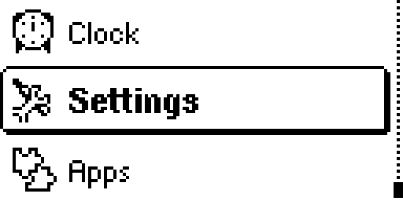 |

| Система на русском | System in English |
| :---: | :---: |
| 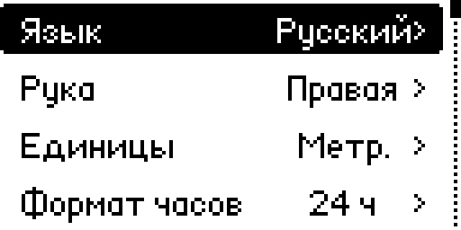 | 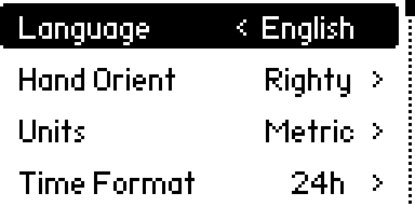 |

| Стартовое меню «ИК-порта» | Приложение «Часы» |
| :---: | :---: |
| 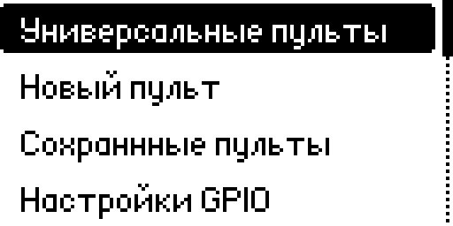 | 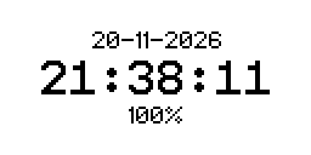 |

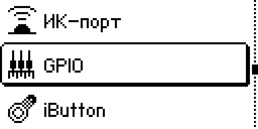

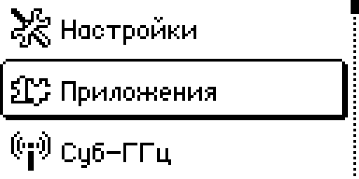

| Меню справки | Страница справки про NFC |
| :---: | :---: |
| 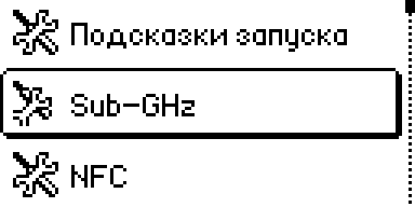 | 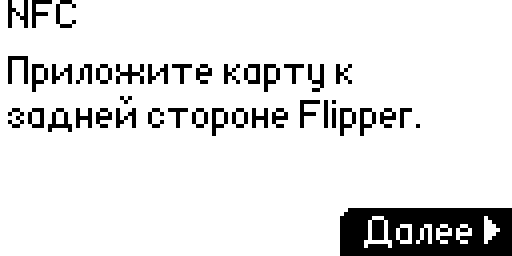 |

### Файловый браузер

В верхней рамке виден переведённый заголовок «Суб-ГГц». `Goroh` — имя файла в списке.

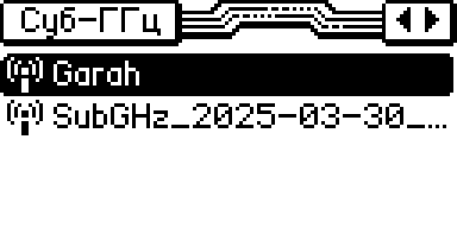

### Все 12 сцен

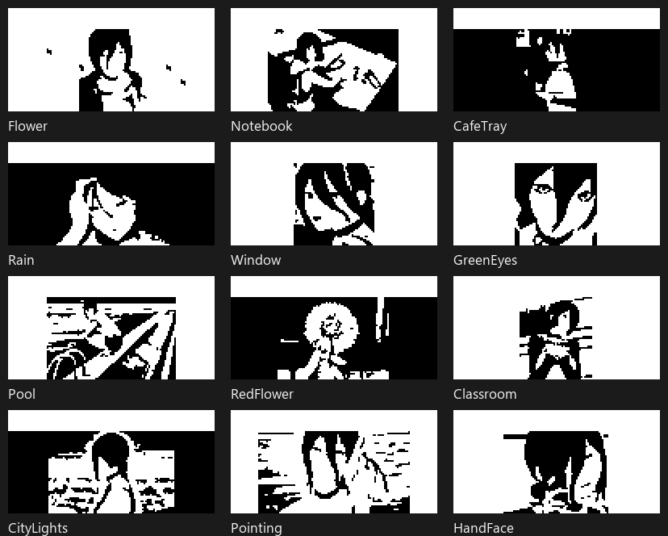

[Главная страница проекта](../../ReadMe.md) · [Результаты проверки](../../RELEASE_NOTES_RU.md)
